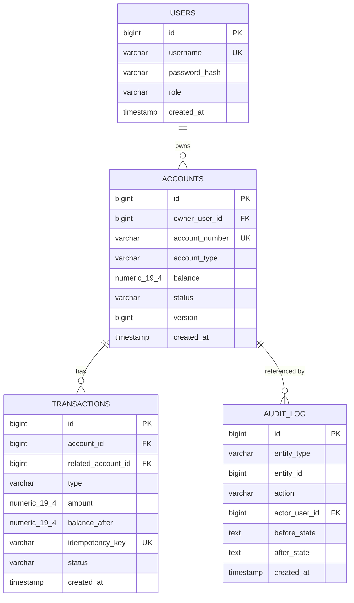

# DESIGN.md — SecureLedger

## Schema

A transfer produces **two** transaction rows — a `TRANSFER_OUT` on the source
account and a `TRANSFER_IN` on the destination — linked via
`related_account_id`, rather than one row with two account references. This
keeps `GET /accounts/{id}/transactions` a simple query against a single
foreign key, and keeps each row's `balance_after` meaningful for the account
it belongs to.

## Why `NUMERIC(19,4)`, never `float`/`double`, for money

`float`/`double` are binary floating point — they cannot represent most
decimal fractions exactly (`0.1 + 0.2 != 0.3` in binary float). Accumulated
over enough deposits/withdrawals, that rounding error becomes a real,
unaccountable discrepancy in a ledger, which is disqualifying for a system
whose entire job is exact accounting. `NUMERIC(19,4)` is an exact
fixed-point decimal type — 19 total digits, 4 after the decimal point,
comfortably covering real-world currency amounts with no representation
error. In Java this maps to `BigDecimal`, and all comparisons in this
codebase use `compareTo`, never `equals`, since `BigDecimal.equals` also
compares scale (`100.00` and `100.0000` would incorrectly compare unequal).

## Why the audit log is append-only

An audit trail whose rows can be edited or deleted after the fact isn't an
audit trail — it's just another mutable table, and it stops being usable as
evidence of what actually happened (for a dispute, a regulator, or
debugging a balance discrepancy). This system enforces append-only in two
layers:
- **Application layer**: `AuditLogRepository` only exposes the inherited
  `save()`/`findX()` methods from `JpaRepository` — no update or delete
  method exists anywhere in the codebase that touches this table.
- **What a real deployment adds**: a DB-level `REVOKE UPDATE, DELETE ON
  audit_log FROM app_role`, so even a bug or a compromised app credential
  can't mutate history — only a separate, more privileged migration role
  could. That's out of scope for this portfolio's local Postgres setup but
  is the actual production answer.

## Isolation level: `READ COMMITTED` + row locking, not `SERIALIZABLE`

**Options considered:**
- **`SERIALIZABLE`** — the DB guarantees transactions behave as if run
  one-at-a-time. Simplest to reason about, but Postgres implements this via
  optimistic conflict detection: transactions can still abort with a
  serialization failure under contention, pushing retry logic onto the
  application, and throughput drops under concurrent write load on the same
  rows — exactly the situation a busy account experiences.
- **`READ COMMITTED` + explicit row locks (`SELECT ... FOR UPDATE`)** —
  the default Postgres isolation level, but with the two rows a transfer
  actually touches (source and destination account) explicitly locked for
  the duration of the transaction. This gives the same real-world guarantee
  we need — no other transaction can read-modify-write those two rows until
  we commit — without the abort-and-retry overhead of `SERIALIZABLE`, and
  without accidentally locking unrelated rows the way a coarser isolation
  level might.

**Recommendation implemented:** `READ COMMITTED` (Postgres/H2 default) +
`SELECT ... FOR UPDATE` via `@Lock(LockModeType.PESSIMISTIC_WRITE)` on
`AccountRepository.findByIdForUpdate`, scoped precisely to the accounts a
given operation touches. The tradeoff is deliberate: it puts the burden of
correctness on explicit, narrow locks instead of a broad isolation
guarantee — more code to get right, but predictable performance and no
surprise transaction aborts under load.

## Locking strategy: pessimistic (not optimistic) for money movement

`Account.version` (a `@Version` column) is present and used for
**optimistic** locking on status-only changes (freeze/unfreeze) — those are
rare, low-contention writes where a lost update just means "retry the
freeze," and optimistic locking avoids holding a lock for no reason.

Balance changes (deposit, withdraw, transfer) use **pessimistic** locking
instead, acquired via `findByIdForUpdate`. The reasoning:
- Optimistic locking detects a lost update *after* it happens (via a failed
  version check on write) and asks the client to retry. For a financial
  transfer, "retry the money movement" is a much worse failure mode than
  briefly blocking a second concurrent request — you don't want a client
  library or a human silently re-submitting a debit.
- Accounts under real load (a popular merchant account, a payroll account)
  have exactly the contention pattern pessimistic locking is built for:
  multiple transfers wanting to touch the same row at once. Blocking one
  until the other commits is the correct, boring, predictable behavior.
- **Deadlock avoidance**: `TransferService` always locks the two accounts
  involved in ascending order of `id`, regardless of which is `from` and
  which is `to`. Without this, transfer A→B and a concurrent transfer B→A
  could each hold one lock and wait on the other — a classic deadlock. Fixed
  lock ordering makes that impossible: both transactions always contend for
  the same first row before the second, so one simply waits for the other.

## Idempotency design

The client sends an `Idempotency-Key` header on `POST /transfers`. That key
is:
1. **Checked first**, before any locking or balance logic: if a transaction
   with that key already exists for the requested source account, the
   original result is returned (`200 OK`) instead of re-executing the
   transfer.
2. **Enforced at the database level**, not just in application code:
   `transactions.idempotency_key` has a `UNIQUE` constraint. Two concurrent
   requests carrying the same key can both pass the initial "does this
   exist yet" check before either commits — the pre-check is a fast path,
   not the actual guarantee. The unique constraint is what actually
   prevents a double-transfer under that race: the second insert fails at
   the DB, and the exception maps to `409 Conflict`.
3. **Split into two DB rows sharing one client-facing key**: a transfer
   produces both a `TRANSFER_OUT` and a `TRANSFER_IN` transaction row, and
   the column is genuinely unique per row — so the client's key is stored as
   `{key}:OUT` and `{key}:IN` internally. The client only ever sees and
   sends the one key; this is an internal storage detail.
4. **Distinguishes a true replay from key reuse with a different payload**:
   if the same `Idempotency-Key` arrives with a different `fromAccountId`
   or `amount` than the original request, that's rejected as
   `DuplicateIdempotencyKeyException` (`409`) rather than silently replayed
   — reusing a key for a materially different request is a client bug, not
   a retry.

## What I'd add for a real production system

A single mutable `balance` column, however carefully locked, is a
simplification. A real ledger would move to **double-entry bookkeeping** —
every movement recorded as a pair of debit/credit entries against a
chart of accounts, with the "balance" being a derived sum rather than a
column that can be directly written — because that makes the ledger
self-verifying (debits always equal credits) and makes reconciliation
against an external system of record (a card network, a correspondent
bank) a matter of comparing entry streams rather than trusting a single
number. I'd pair that with the **outbox pattern** for anything that needs
to notify other systems of a completed transfer (fraud scoring, statement
generation, webhooks to the account holder) — writing the outbound event
to a table in the same transaction as the balance change, then relaying it
asynchronously, so "the transfer happened" and "downstream systems heard
about it" can't drift apart the way they would with a direct synchronous
call or a fire-and-forget message published outside the transaction. And
I'd add scheduled **reconciliation jobs** that independently recompute
account balances from the transaction/audit history and alert on any
drift — treating the stored balance as a cache of derived state that
should be continuously checked, not a number that's simply trusted.
